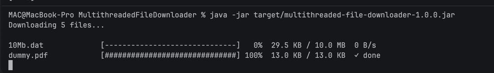

# Multithreaded File Downloader

A command-line download manager written in plain Java 21. It downloads several files in parallel on a thread pool, shows a live progress bar for each file, retries temporary failures with exponential backoff, and resumes interrupted downloads instead of starting over.

<!-- Record the terminal while it runs and save it as docs/demo.gif -->


## Features

- **Parallel downloads**: a fixed-size `ExecutorService` limits how many files download at once. The remaining files wait in the pool's queue.
- **Live progress bars**: a dedicated renderer thread redraws one bar per file (percentage, size and speed) using ANSI escape codes. In IDE consoles that can't redraw in place, it prints a snapshot every second instead.
- **Retry with exponential backoff**: temporary failures (HTTP 429, 408, 5xx, timeouts, dropped connections) are retried after 1 s, then 2 s, and so on, up to a cap. The server's `Retry-After` header is respected. Permanent errors like 404 are not retried.
- **Resumable downloads**: data is written to `name.part` and renamed only when complete. If a download is interrupted, the next attempt sends an HTTP `Range` header and continues from where it stopped. It falls back to a full download when the server ignores `Range`.
- **Failure isolation**: a failed download returns a result object instead of throwing, so one bad URL never stops the others.
- **Tested**: unit tests, plus integration tests that run against an embedded HTTP server, covering retries, resume, dropped connections and concurrent progress updates.

## Example output

```
10Mb.dat             [###############---------------]  52%  5.2 MB / 10.0 MB  5.2 MB/s
dummy.pdf            [##############################] 100%  13.0 KB / 13.0 KB  ✓ done
png                  [##############################] 100%  7.9 KB / 7.9 KB  ✓ done

===== Summary =====
✅ dummy.pdf | 13264 bytes | 323 ms
✅ 10Mb.dat | 10485760 bytes | 1153 ms
✅ png | 8090 bytes | 380 ms
❌ this-file-does-not-exist.zip | error: HTTP 404
```

## How it works

```
Main ──► DownloadManager ──creates──► ProgressTracker  (ConcurrentHashMap + AtomicLong)
              │                            ▲      ▲
              │ starts                     │reads │writes
              ├────────► ProgressRenderer ─┘      │
              │          (own thread)             │
              │ submits N tasks                   │
              └────────► DownloadTask × N ────────┘
                         (Callable on the pool) ──returns──► DownloadResult
```

| Class | Responsibility |
|---|---|
| `DownloadManager` | Creates the thread pool, submits one task per URL, collects the `Future` results |
| `DownloadTask` | Downloads one file: connection, Range/resume, read-write loop, retry loop |
| `RetryPolicy` | Decides whether to retry and how long to wait (exponential backoff with a cap) |
| `ProgressTracker` | Thread-safe shared state: bytes downloaded, total size and status per file |
| `ProgressRenderer` | Background thread that draws the progress bars |
| `DownloadResult` | Immutable result of one download (success, size, time, attempts, error) |

### Concurrency details

- Progress counters are `AtomicLong`s in a `ConcurrentHashMap`, so many download threads update them without locks and without losing updates. A test checks this with 8 threads × 10 000 updates.
- The renderer's `running` flag is `volatile`, so the stop signal from the manager thread is visible to the renderer thread.
- Only the renderer thread writes to the console, which keeps the output from mixing.
- The renderer is a daemon thread and is joined before the summary prints.

## Running it

Requirements: **Java 21+** and **Maven** (for the tests).

```bash
# Run the tests
mvn test

# Build a runnable jar
mvn package
java -jar target/multithreaded-file-downloader-1.0.0.jar

# Download your own files
java -jar target/multithreaded-file-downloader-1.0.0.jar https://example.com/a.zip https://example.com/b.pdf
```

Without Maven:

```bash
javac -d out $(find src -name "*.java")
java -cp out Main
```

The live, in-place progress bars only appear in a real terminal. IntelliJ's Run window prints snapshots instead.

Files are saved in `downloads/`. If you stop the program partway through, run it again and the unfinished downloads continue from their `.part` files.

## Possible next steps

- Split one large file into several byte ranges downloaded in parallel
- Verify a checksum (SHA-256) after download
- Read URLs from a text file and add a `--threads` option
- Add random jitter to the backoff delays
